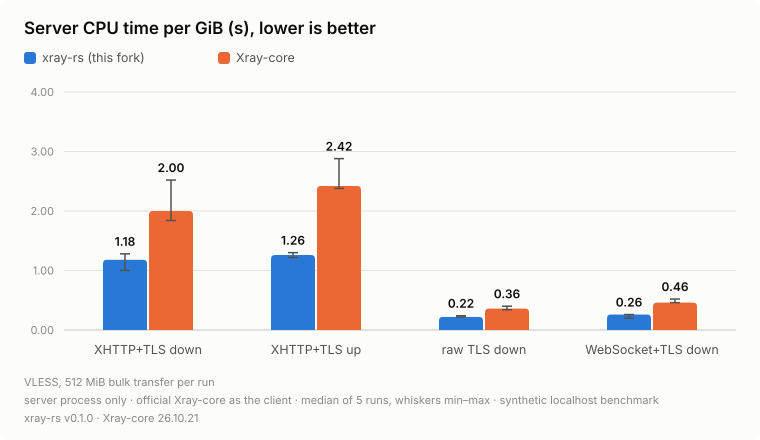
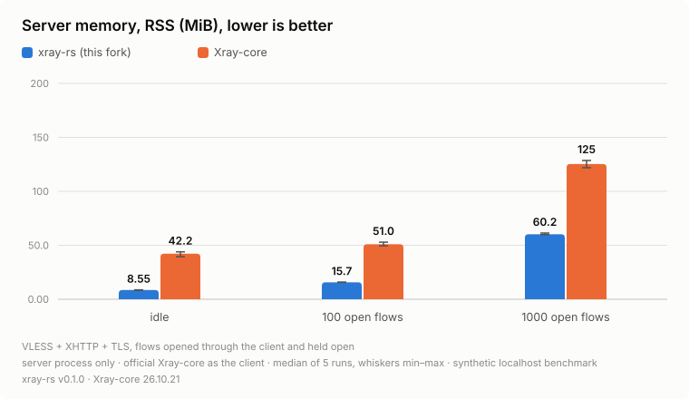
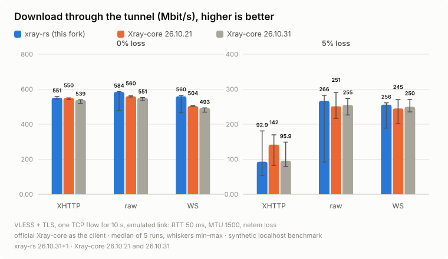

# xray-rs

A Rust server core that can stand in for `xray-linux-amd64` in the 3x-ui panel.
Clients keep using the regular Xray core.

This is a fork of [aimalygin/xray-rust](https://github.com/aimalygin/xray-rust),
a Rust client core for Xray-style configs. The server lives in the new
`crates/xray-server` crate and reuses the upstream config parser, routing
matcher and WireGuard client. The rest of the upstream workspace is kept as is.

The server crate and every workspace crate it is built from (`xray-config`,
`xray-proxy`, `xray-transport`, `xray-routing`, `xray-utls`,
`xray-vless-encryption`, `xray-wireguard`) are `#![forbid(unsafe_code)]`.

## What works

| Area | Supported |
|---|---|
| Inbound protocols | VLESS (including XTLS Vision and VLESS encryption), VMess (AEAD), Trojan, Shadowsocks (AEAD and 2022, multi-user), Hysteria2, SOCKS 5/4a and HTTP proxy (`mixed`, with keep-alive), dokodemo-door / `tunnel` (including `followRedirect`) |
| Security | TLS (`minVersion`, `maxVersion`, `cipherSuites`, `rejectUnknownSni`), REALITY (dest mirroring and padding, `mldsa65Seed`), or plain behind nginx |
| Transports | XHTTP over HTTP/1.1 and HTTP/2 (packet-up, stream-up, stream-one, Xray 26 obfuscation settings, `responseHeaders`), raw TCP (including `header: http`), WebSocket (with early data), HTTPUpgrade, gRPC (gun and multi mode); `acceptProxyProtocol`; `sockopt` (`mark`, `interface`, `tcpFastOpen`, keepalive, `tcpCongestion`, `tcpUserTimeout`, `tcpMaxSeg`, `v6only`, `tcpMptcp`, `tproxy`) |
| VLESS / Trojan | TCP, UDP, Mux.Cool and XUDP; `fallbacks` by `name`, `alpn` and `path` with PROXY protocol v1/v2 |
| Sniffing | `destOverride` `http`, `tls`, `quic`, `fakedns`; `routeOnly`, `metadataOnly`, `domainsExcluded` |
| Outbound | `freedom` / `direct` (every `domainStrategy`, `fragment`, `noises`, `redirect`), `blackhole` / `block`, `wireguard` (Cloudflare WARP), `socks`, `vless` (raw, WS, gRPC, TLS, REALITY, Vision), `vmess`, `trojan`, `shadowsocks`, `http`, `dns`, `loopback`; `sendThrough`, `proxySettings`, `mux`; balancers (`random`, `roundRobin`, `leastPing`, `leastLoad`) with `observatory` and `burstObservatory` |
| Routing | `domain`, `geosite`, `ip`, `geoip`, `port`, `network`, `inboundTag`, `user`, `source`, `sourcePort`, `localPort`, `localIP`, `protocol`, `attrs`, `vlessRoute`, `balancerTag`; `domainStrategy` AsIs, IPIfNonMatch, IPOnDemand |
| DNS and policy | built-in `dns` section (servers, `hosts`, `queryStrategy`), `fakedns`; `policy` levels (timeouts, `bufferSize`, per-user stats and online tracking) |
| 3x-ui | `-c`, `run -test -c`, `-version`; gRPC `StatsService`, `HandlerService` (users for VLESS, VMess, Trojan and Shadowsocks, `AddInbound`, `RemoveInbound`, `AddOutbound`, `RemoveOutbound`), `RoutingService`, `LoggerService`, `ObservatoryService`; the `log` section (`loglevel`, `access`, `error`, `maskAddress`, `dnsLog`); `metrics` (`/debug/vars`); `version` |

Tested against the official Xray-core 26.10.31 as client, outbound peer,
WireGuard peer and `xray api` client.

## Resource use

Same server config for both cores, the official Xray-core as the client, only
the server process measured, on loopback. Median of 5 runs, whiskers show
min and max.

<picture>
  <source media="(prefers-color-scheme: dark)" srcset="assets/server-cpu-dark.svg">
  
</picture>

<picture>
  <source media="(prefers-color-scheme: dark)" srcset="assets/server-memory-dark.svg">
  
</picture>

Throughput over an emulated link (network namespace with netem: 50 ms RTT,
MTU 1500, 0, 1 and 5% packet loss). Without loss xray-rs is 8 to 20% faster.
With loss the kernel's TCP recovery dominates and both cores land within run
to run noise.

<picture>
  <source media="(prefers-color-scheme: dark)" srcset="assets/server-throughput-dark.svg">
  
</picture>

## Not supported yet

- Skipped with a warning: XHTTP over HTTP/3, mKCP, the `hysteria`, `masque`
  and `xdrive` transports, WireGuard and MASQUE inbounds, Hysteria and
  MASQUE outbounds.
- `reverse` (both the `reverse` section and VLESS users' `reverse`), `env`,
  `geodata`, `transport`: skipped with a warning.
- `sockopt` on outbounds other than `freedom`; `tcpWindowClamp` and
  `customSockopt`.
- `metrics` serves `/debug/vars` without Go's `memstats`, and no `pprof`.

## Build

```bash
cargo build --release -p xray-server
```

The binary is `target/release/xray-server`. It runs on glibc 2.34 or newer
(Ubuntu 22.04, Debian 12 and later).

## Install into 3x-ui

`scripts/install-3x-ui.sh` tests the current panel config with the new core,
keeps the original core as `xray-linux-amd64.orig` and rolls back if the core
does not come up. Install or update from the latest release:

```bash
curl -fsSL https://raw.githubusercontent.com/VLOD-ZDOV/xray-rs/main/scripts/install-3x-ui.sh | sudo bash
```

Back to the original Xray core:

```bash
curl -fsSL https://raw.githubusercontent.com/VLOD-ZDOV/xray-rs/main/scripts/install-3x-ui.sh | sudo bash -s -- --rollback
```

From a checkout:

```bash
sudo ./scripts/install-3x-ui.sh                      # latest release
sudo ./scripts/install-3x-ui.sh --build              # build from source here
sudo ./scripts/install-3x-ui.sh path/to/xray-server  # a binary you have
sudo ./scripts/install-3x-ui.sh --rollback           # back to the original core
```

Manual steps:

```bash
systemctl stop x-ui
cd /usr/local/x-ui/bin
cp xray-linux-amd64 xray-linux-amd64.orig
cp /path/to/xray-server xray-linux-amd64
./xray-linux-amd64 run -test -c config.json
systemctl start x-ui
```

Do not use the panel's "update Xray" button afterwards: it overwrites the core.
To roll back, copy `xray-linux-amd64.orig` back.

For a debug log, stop the panel and run
`XRAY_SERVER_DEBUG=1 ./xray-linux-amd64 -c config.json`.

## License

[MPL-2.0](LICENSE), same as upstream. Third-party data notices are in
[THIRD_PARTY_NOTICES.md](THIRD_PARTY_NOTICES.md).
